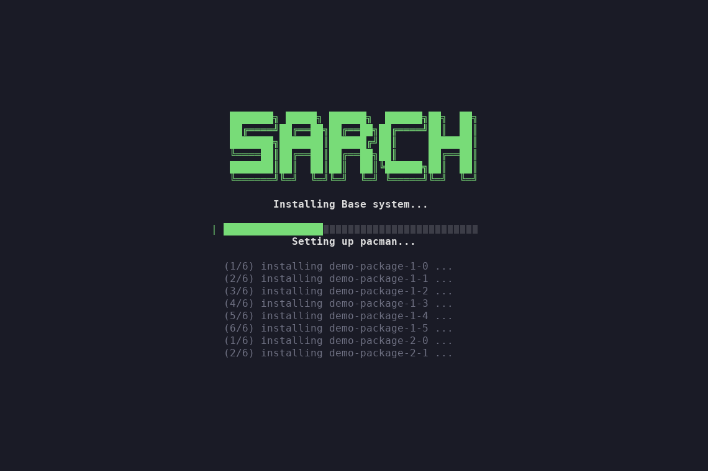

```
 ███████╗ █████╗ ██████╗  ██████╗██╗  ██╗
 ██╔════╝██╔══██╗██╔══██╗██╔════╝██║  ██║
 ███████╗███████║██████╔╝██║     ███████║
 ╚════██║██╔══██║██╔══██╗██║     ██╔══██║
 ███████║██║  ██║██║  ██║╚██████╗██║  ██║
 ╚══════╝╚═╝  ╚═╝╚═╝  ╚═╝ ╚═════╝╚═╝  ╚═╝
```

**Meine persönliche Arch-Linux-Distribution – Dotfiles, Themes & Installationsskript**

[🇬🇧 English](README.md) · 🇩🇪 Deutsch

[](LICENSE)
[](https://archlinux.org/)
[](https://hyprland.org/)
[](https://www.gnu.org/software/bash/)
[](https://github.com/InioX/matugen)

---

## 🗂️ Überblick

**sArch** bringt einen Rechner mit einem einzigen Befehl vom Arch-Linux-Live-ISO zu einem fertig eingerichteten **Hyprland**-Desktop. Enthalten sind das Installationsskript, alle Dotfiles, Schriften, ein GTK-Theme und ein Farbsystem auf Basis von [Matugen](https://github.com/InioX/matugen), das sich nach dem aktuellen Hintergrundbild richtet.

Der Installer-Bildschirm ist an [Omarchy](https://github.com/basecamp/omarchy) angelehnt: Das Logo steht in der Mitte, darunter zeigt jede Stage einen Fortschrittsbalken, und die neuesten Zeilen des Install-Logs laufen gedimmt darunter mit.



---

## 🚀 Installation

> **Voraussetzungen:** Das Arch-Linux-Live-ISO im **UEFI-Modus** gebootet, eine funktionierende Internetverbindung und Partitionen für **boot (EFI)**, **swap** und **root**. Fehlen die Partitionen noch, kann der Installer `cfdisk` für dich öffnen.

```bash
curl -fsSL https://raw.githubusercontent.com/SchnuBby2205/sArch/main/bootstrap.sh | bash
```

`bootstrap.sh` installiert `git` und `terminus-font`, klont das Repo nach `~/sArch` (oder `$SARCH_DIR`) und startet `install.sh` mit dem Hauptmenü:

- **Settings** – alle Installationseinstellungen prüfen oder ändern (Partitionen, Hostname, Benutzer, CPU, GPU, Zeitzone, Locale, Tastaturlayout, Kernel, Backup-/Spiele-Laufwerke). Die Werte werden in `configs/installConfigs/install_settings` gespeichert.
- **Install** – eine Stage von Hand starten (normalerweise startest du nur *Base System*, der Rest läuft von selbst weiter).
- **Exit**

### Installations-Stages

| # | Stage | Läuft | Was passiert |
|---|-------|-------|--------------|
| 1 | **Base System** | Live-ISO | Fragt fehlende Einstellungen ab, formatiert und mountet die Partitionen (nach Eingabe von `YES`), richtet die Mirrors mit `reflector` ein, führt `pacstrap` aus |
| 2 | **Arch-Chroot** | automatisch in `arch-chroot` | Zeitzone, Locale, Tastaturlayout, Konsolenschrift, GRUB, Hostname, Root- und Benutzerpasswort, NetworkManager; danach Neustart |
| 3 | **Desktop** | erster Login auf **tty1** | Aktiviert multilib, installiert System-, Audio- und Programmpakete sowie `yay`, verlinkt die Configs, installiert Schriften, GTK-Theme und Hintergrundbilder, aktiviert SDDM; danach Neustart |
| 4 | **Configs** | erster Hyprland-Start (kitty) | GPU-Treiber (AMD/NVIDIA), `dxvk-bin`, Steam, Firefox-Profil, optional Backups / persönliche Anpassungen, erstes Hintergrundbild + Matugen-Farben; danach Neustart |

Jede Stage übergibt selbstständig an die nächste (chroot-Aufruf, `.bashrc`-Hook auf tty1, Hyprland-Autostart). Die Hooks werden wieder entfernt, sobald sie ihren Zweck erfüllt haben.

### Optionen

Diese Schalter stehen in `configs/installConfigs/install_settings`:

| Einstellung | Wirkung |
|-------------|---------|
| `debug=true` | Zeigt die Ausgabe der Befehle live statt des Installer-Bildschirms |
| `dryRun=true` | Protokolliert die Befehle nur; der Fortschrittsbalken bewegt sich trotzdem, so kannst du den ganzen Ablauf vorab ansehen |
| `defaults=true` | Überspringt in der letzten Stage die Frage nach Backups/Anpassungen |

Alles wird in `~/sArch-install.log` protokolliert. Schlägt ein Befehl fehl, wird der Titel der Stage rot und das Ende des Logs angezeigt.

**Vorschau des Installer-Bildschirms**, ohne etwas zu installieren:

```bash
./install.sh presentationDemo
```

---

## 🖥️ Installer-Bildschirm

| Datei / Einstellung | Zweck |
|---------------------|-------|
| `logo.txt` | Das zentrierte Logo – lässt sich durch beliebige ASCII-Art ersetzen |
| `scripts/presentation.sh` | Layout, Fortschrittsbalken, Spinner und Live-Log |
| `consoleFont` in `configs/installConfigs/constants` | Schrift auf dem TTY (Standard `ter-v22b`, leer = nicht ändern). Wird auch in `/etc/vconsole.conf` eingetragen |

Das Layout wird für jeden Bildschirm neu berechnet und funktioniert daher sowohl auf dem TTY als auch in kitty. Zeichen, die die Schrift der Linux-Konsole nicht kennt, werden durch ASCII-Zeichen ersetzt.

---

## 🎨 Theming

- **[Matugen](https://github.com/InioX/matugen)** erzeugt das Farbschema aus dem aktuellen Hintergrundbild und füllt die Vorlagen in `configs/matugen/templates/` (Hyprland, kitty, rofi, dunst, btop, yazi, GTK, Qt und Firefox über pywalfox).
- **`themes/Matugen/`** ist das GTK-3/4-Theme, das diese Farben übernimmt; es wird nach `~/.themes` installiert.
- Die Hintergrundbilder werden nach `~/Bilder/Wallpapers` geklont. `sarch_change_wallpaper.sh` wechselt das Hintergrundbild und lässt Matugen mit der gewählten Akzentfarbe neu laufen.

---

## 📁 Aufbau des Repos

```
sArch/
├── bootstrap.sh            # Einstieg auf dem Live-ISO (curl | bash)
├── install.sh              # Hauptmenü & Aufruf der Stages
├── logo.txt                # Logo für den Installer-Bildschirm
├── scripts/
│   ├── io.sh               # Ausgabe, Eingaben, Menüs (list), Einstellungsmenü
│   ├── presentation.sh     # Installer-Bildschirm im Omarchy-Stil
│   ├── checks.sh           # UEFI-/Partitionsprüfungen, Abfrage der Einstellungen
│   ├── commands.sh         # runCMDS, dryRun, safeCMD
│   └── installs.sh         # Die vier Stages, Backups, persönliche Anpassungen
├── configs/
│   ├── installConfigs/     # Einstellungen, Konstanten, Paket- & Auswahllisten
│   ├── hypr/               # Hyprland (Lua-Config)
│   ├── kitty/ rofi/ dunst/ nvim/ yazi/ btop/ qt5ct/ qt6ct/ neru/
│   └── matugen/            # Matugen-Config & Vorlagen
├── bin/                    # sarch_*-Hilfsskripte + Settings-Tool
├── fonts/                  # Mitgelieferte Schriften
├── themes/Matugen/         # GTK-Theme
└── docs/                   # Screenshots
```

Configs und `bin/` werden nach `~/.config` bzw. `~/.config/sArch/bin` **verlinkt** (Symlinks). Änderungen im Repo wirken also sofort.

### Paketlisten

Die Dateien in `configs/installConfigs/` (`systemdeps`, `audiodeps`, `programs`, `fonts`, `amd`, `nvidia`) haben ein einfaches Format:

```
Anzeigename...       # Zeile 1: Beschriftung im Fortschrittsbildschirm
5                    # Zeile 2: Stand des Balkens nach dieser Liste (von 20)
paket-a paket-b      # weitere Zeilen: Pakete (Brace-Expansion funktioniert)
```

`cpus`, `gpus`, `kernels`, `timezones`, `locales` und `keymaps` liefern die Auswahl für das Einstellungsmenü. Ein Eintrag `Other` erlaubt eine freie Eingabe.

---

## 🧰 Hilfsskripte (`bin/`)

| Skript | Zweck |
|--------|-------|
| `sarch_change_wallpaper.sh` | Hintergrundbild und daraus eine Akzentfarbe per rofi wählen, dann die neuen Farben anwenden |
| `sarch_create_thumbnails.sh` | Vorschaubilder der Hintergrundbilder erzeugen/aktualisieren |
| `sarch_change_volume.sh` / `sarch_volume.sh` | Lautstärke mit Benachrichtigung / rofi-Menü |
| `sarch_powermenu.sh` | Power-Menü (rofi) |
| `sarch_settings.sh` | Einstellungsstarter (Hyprland, Dunst, Schrift) |
| `sarch_fonts.sh` | Schriftvorschau & -auswahl per rofi |

---

## 💾 Backups & persönliche Anpassungen

In der letzten Stage kannst du zusätzlich wählen:

- **Backups einspielen:** `BACKUP_DEV` unter `BACKUP_MNT` mounten und Lutris, die zsh-History, Git-Config/-Zugangsdaten, TeamSpeak und das Firefox-Profil aus `BACKUP_DIR` verlinken. Vorhandene Dateien werden in `*_bak_<Zeitstempel>` umbenannt; nur das frisch angelegte Firefox-Profil wird ersetzt.
- **Persönliche Anpassungen installieren:** Backup- und Spiele-Laufwerk in die `fstab` eintragen (per UUID), SDDM-Autologin in Hyprland einrichten, GRUB-Timeout auf 0 setzen.

Beides ist auf meinen eigenen Rechner zugeschnitten. Passe vorher die Werte `BACKUP_*` / `GAMES_*` in den Einstellungen an oder überspringe den Schritt.

---

## ⚠️ Hinweis

Das ist eine **persönliche Konfiguration**, zugeschnitten auf meine Hardware und meine Vorlieben. Stage 1 **formatiert die gewählten Partitionen ohne weitere Warnung**, prüfe sie also doppelt. Forken und Anpassen ist ausdrücklich erwünscht – am besten zuerst in einer VM ausprobieren.

---

## 📄 Lizenz

Veröffentlicht unter der [MIT-Lizenz](LICENSE).

---

Mit ❤️ und Arch Linux gemacht von [SchnuBby2205](https://github.com/SchnuBby2205)
